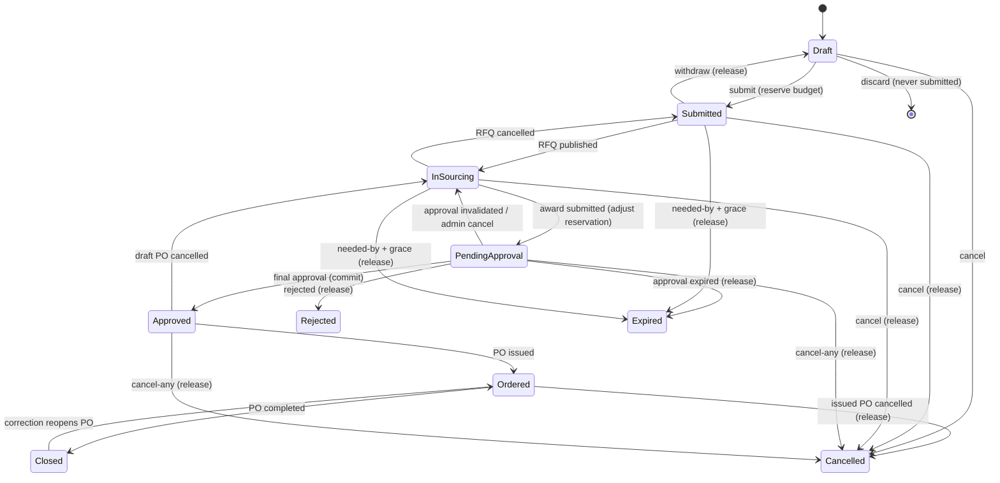
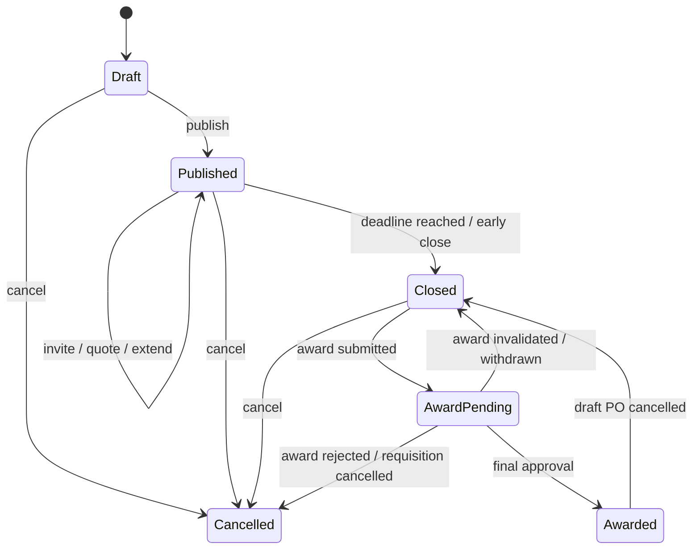
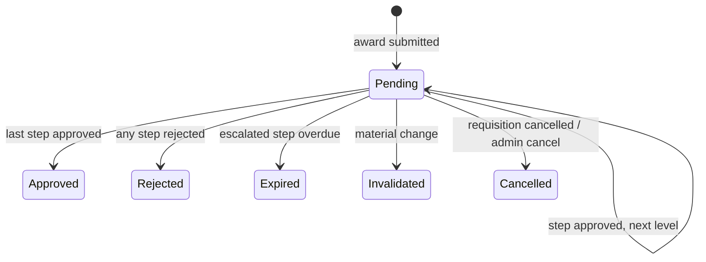
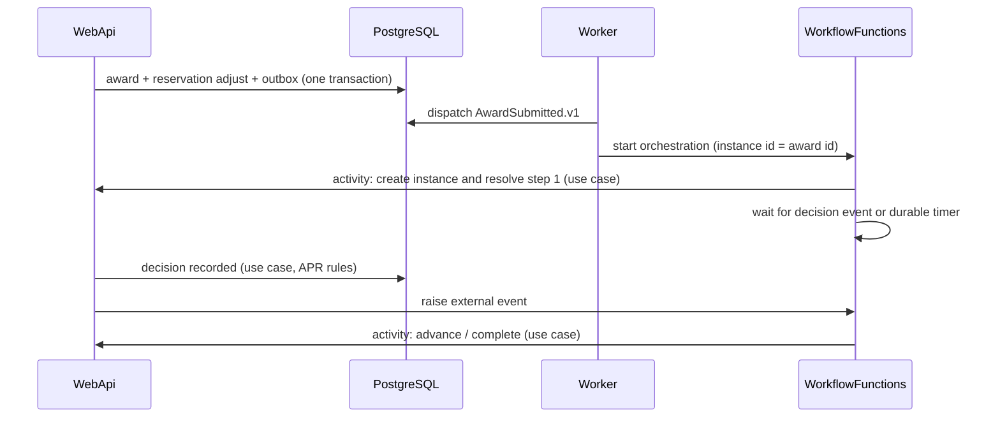
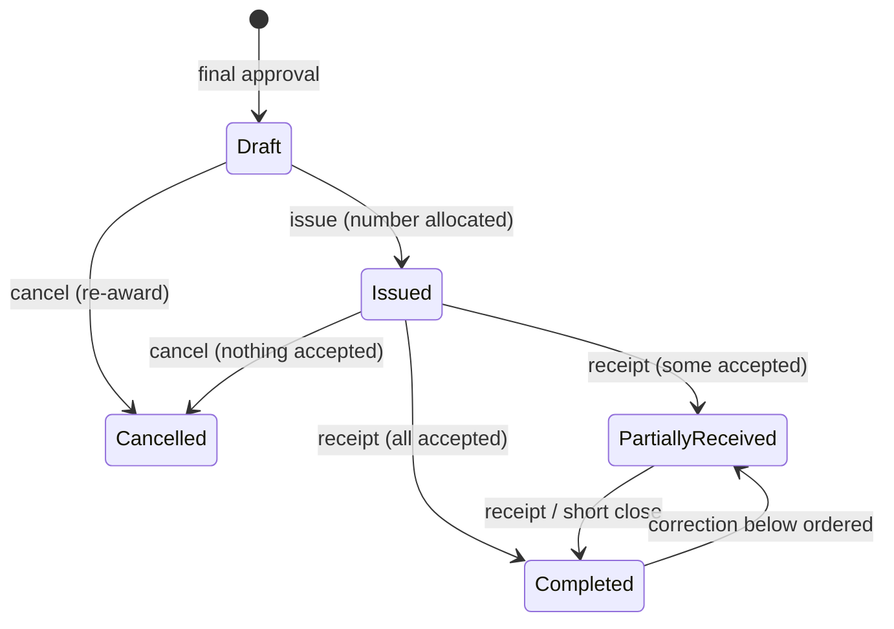
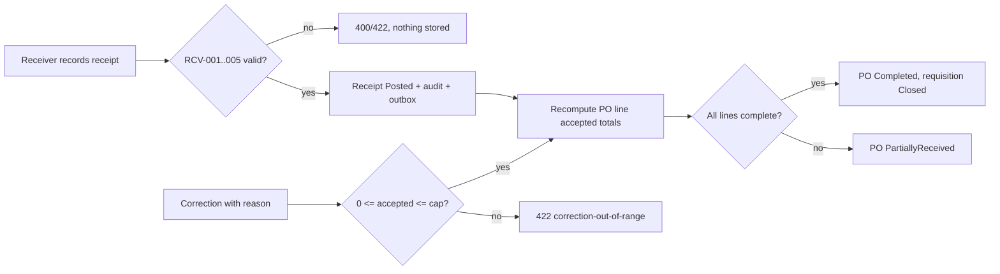
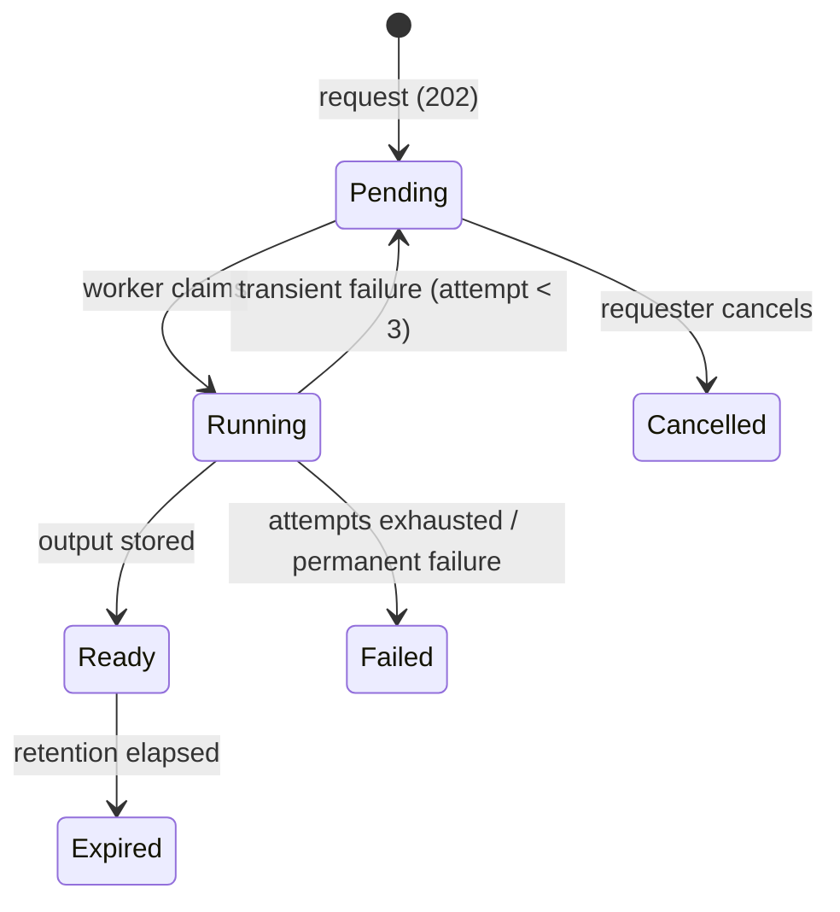

# Workflows and state machines

Every transition below lists actor, guard (rule IDs), result, emitted event ([event-catalog.md](event-catalog.md)), audit action (AUD-001) and idempotency behavior. Any transition not listed is invalid and returns `409 invalid-transition` with the current state. All transition commands require `If-Match` (optimistic concurrency) except system transitions, which are idempotent by design ([api-guidelines.md](api-guidelines.md)).

Event names such as `RequisitionSubmitted.v1` denote the integration event `procurement.requisition.submitted` version 1 in the event catalog (PascalCase type name ↔ dotted wire name).

Notation: **Actor** uses role names from [permissions.md](permissions.md); "System" = Worker, scheduler or Durable activity calling the same Application use case.

## 1. Purchase requisition

| From | To | Actor | Guard | Result | Event | Audit | Idempotency |
|---|---|---|---|---|---|---|---|
| — | Draft | Requester | REQ-002, cost center active (ORG-003) | Draft created, revision 1 | — | `requisition.draft.created` | `Idempotency-Key` on create |
| Draft | (deleted) | Requester (own) | REQ-010 never submitted | Removed | — | `requisition.draft.discarded` | repeat → 404 |
| Draft | Submitted | Requester (own) | REQ-004, REQ-005, BUD-004/005/006/008 | Snapshot stored; reservation `Reserved` | `RequisitionSubmitted.v1`, `BudgetReservationCreated.v1` | `requisition.submitted` | `Idempotency-Key`; replay returns stored response |
| Submitted | Draft | Requester (own) | REQ-007 no published RFQ | Reservation `Released (Withdrawn)`; revision + 1 | `RequisitionWithdrawn.v1`, `BudgetReservationReleased.v1` | `requisition.withdrawn` | `Idempotency-Key` |
| Submitted | InSourcing | Buyer | SRC-001/004/005/006 (RFQ published) | Requisition linked to RFQ | `RfqPublished.v1` | `requisition.sourcing-started` | via RFQ publish key |
| InSourcing | Submitted | Buyer | SRC-020 | RFQ cancelled | `RfqCancelled.v1` | `rfq.cancelled` | via RFQ key |
| InSourcing | PendingApproval | Buyer | SRC-016/017/018/019, BUD-009 | Award `PendingApproval`; reservation adjusted; approval start queued | `AwardSubmitted.v1` | `award.submitted` | `Idempotency-Key` |
| PendingApproval | InSourcing | System / ProcurementManager | APR-012 (invalidation) or APR-015 (admin cancel) | Award `Invalidated`; reservation stays `Reserved` | `ApprovalInvalidated.v1` | `approval.invalidated` | keyed by (approval instance, cause) |
| PendingApproval | Approved | Approver (final step) | APR-004/005/007/008/013 | Award `Approved`; reservation `Committed`; PO draft queued | `ApprovalCompleted.v1`, `BudgetReservationCommitted.v1` | `approval.approved` | APR-014 |
| PendingApproval | Rejected | Approver (any step) | APR-004/009 reason | Award `Rejected`; RFQ `Cancelled`; reservation `Released (Rejected)` | `ApprovalRejected.v1`, `BudgetReservationReleased.v1` | `approval.rejected` | APR-014 |
| PendingApproval | Expired | System (durable timer) | APR-011 | Reservation `Released (Expired)` | `ApprovalExpired.v1`, `BudgetReservationReleased.v1` | `approval.expired` | keyed by instance |
| Approved | InSourcing | Buyer / ProcurementManager | PUR-008 (draft PO cancel) | Award `Withdrawn`; reservation back to `Reserved` | `PurchaseOrderCancelled.v1` | `purchase-order.cancelled` | `Idempotency-Key` |
| Approved | Ordered | Buyer | PUR-003 | PO `Issued` with number | `PurchaseOrderIssued.v1` | `purchase-order.issued` | PUR-006 |
| Ordered | Closed | System | PUR-009 | — | `PurchaseOrderCompleted.v1` | `purchase-order.completed` | recomputed state; no-op if unchanged |
| Closed | Ordered | System | PUR-009 after RCV-007 | — | `PurchaseOrderReopened.v1` | `purchase-order.reopened` | same |
| Ordered | Cancelled | ProcurementManager | PUR-008 (issued, nothing accepted) | Commitment `Released (OrderCancelled)` | `PurchaseOrderCancelled.v1`, `BudgetReservationReleased.v1` | `purchase-order.cancelled` | `Idempotency-Key` |
| Draft/Submitted/InSourcing | Cancelled | Requester (own) | REQ-008 reason; no award pending | Release if reserved; open RFQ cancelled | `RequisitionCancelled.v1` (+ release) | `requisition.cancelled` | `Idempotency-Key` |
| Any non-terminal before Ordered | Cancelled | ProcurementManager (`requisitions.cancel-any`) | REQ-008 reason | Release; RFQ/approval/PO draft cancelled | `RequisitionCancelled.v1` (+ release) | `requisition.cancelled` | `Idempotency-Key` |
| Submitted/InSourcing | Expired | System (scheduler) | REQ-009 | Release `Expired`; open RFQ cancelled | `RequisitionExpired.v1` (+ release) | `requisition.expired` | keyed by (requisition, revision) |

Terminal states: `Rejected`, `Cancelled`, `Expired`, `Closed` (Closed can only be reopened by a receipt correction, PUR-009).

## 2. Request for quotation

| From | To | Actor | Guard | Result | Event | Audit | Idempotency |
|---|---|---|---|---|---|---|---|
| — | Draft | Buyer | SRC-001/002 | RFQ with requisition snapshot, pinned `SourcingPolicy` | — | `rfq.created` | `Idempotency-Key` |
| Draft | Published | Buyer | SRC-003/004/005 or SRC-006 waiver | Requisition `InSourcing`; invitations notified | `RfqPublished.v1` | `rfq.published` (+ `waiver.recorded`) | `Idempotency-Key` |
| Published | Published | Buyer | SRC-007 invite, SRC-008/009/010 quote, SRC-011 extend | Invitation/quote revision/deadline appended | `QuoteRecorded.v1`, `RfqDeadlineExtended.v1` | per action | `Idempotency-Key` per command |
| Published | Closed | System at deadline / Buyer early close | SRC-012 | Revisions frozen; comparison computed (SRC-013/014/015) | `RfqClosed.v1` (carries the comparison status) | `rfq.closed` | system close keyed by (rfq, deadline) |
| Closed | AwardPending | Buyer | SRC-016/017/018/019 | Award `PendingApproval` | `AwardSubmitted.v1` | `award.submitted` | `Idempotency-Key` |
| AwardPending | Closed | System | APR-012 / award withdrawal | Award `Invalidated`/`Withdrawn`; re-award allowed | `ApprovalInvalidated.v1` | `award.invalidated` | keyed by cause |
| AwardPending | Awarded | System | APR-013 | Award `Approved` | `ApprovalCompleted.v1` | — | — |
| AwardPending | Cancelled | System | APR-009, REQ-008 | Award `Rejected`/`Cancelled` | — | `rfq.cancelled` | — |
| Awarded | Closed | System | PUR-008 draft PO cancel | Award `Withdrawn` | — | `award.withdrawn` | — |
| Draft/Published/Closed | Cancelled | Buyer | SRC-020 reason | Requisition `Submitted` | `RfqCancelled.v1` | `rfq.cancelled` | `Idempotency-Key` |

Quote revision states: `Current → Superseded` (revise) and `Current → Withdrawn` (withdraw); both only while the RFQ is `Published` (SRC-009).

## 3. Approval instance and steps

| From | To | Actor | Guard | Result | Event | Audit | Idempotency |
|---|---|---|---|---|---|---|---|
| — | Pending | System (activity) | APR-001/002/003/006 | Steps created; step 1 assigned with due time | `ApprovalStarted.v1`, `ApprovalStepAssigned.v1` | `approval.started` | instance ID = award ID |
| Step Pending | Step Approved (not last) | Assignee | APR-004/005/007/008 | Next step assigned | `ApprovalStepAssigned.v1` | `approval.step.approved` | APR-014 |
| Step Pending (last) | Instance Approved | Assignee | APR-004/005/007/008/013 | See requisition table | `ApprovalCompleted.v1` | `approval.approved` | APR-014 |
| Step Pending | Instance Rejected | Assignee | APR-009 reason | See requisition table | `ApprovalRejected.v1` | `approval.rejected` | APR-014 |
| Step Pending | Step Pending (delegated) | Assignee | APR-010 | Assignee changed, due unchanged | `ApprovalStepAssigned.v1` | `approval.step.delegated` | `Idempotency-Key` |
| Step Pending | Step Pending (reminded) | System timer at 72 h | APR-011 | Reminder notification queued | `ApprovalReminderDue.v1` | `approval.step.reminded` | keyed by (step, reminder) |
| Step Pending | Step Pending (escalated) | System timer at 120 h | APR-011, escalations < max | Escalation group assigned, new due | `ApprovalStepEscalated.v1` | `approval.step.escalated` | keyed by (step, escalation n) |
| Step Pending (escalated, overdue) | Instance Expired | System timer | APR-011 | See requisition table | `ApprovalExpired.v1` | `approval.expired` | keyed by instance |
| Pending | Invalidated | System | APR-012 | Pending steps `Cancelled` | `ApprovalInvalidated.v1` | `approval.invalidated` | keyed by (instance, cause) |
| Pending | Cancelled | System / ProcurementManager | REQ-008 / APR-015 reason | Pending steps `Cancelled` | `ApprovalCancelled.v1` | `approval.cancelled` / `approval.administered` | `Idempotency-Key` |

## 4. Purchase order

| From | To | Actor | Guard | Result | Event | Audit | Idempotency |
|---|---|---|---|---|---|---|---|
| — | Draft | System | PUR-001/002 | Snapshot copied from award | `PurchaseOrderDrafted.v1` | `purchase-order.created` | unique award ID |
| Draft | Draft | Buyer | PUR-002 editable fields | Delivery data updated | — | `purchase-order.updated` | `If-Match` |
| Draft | Issued | Buyer | PUR-003/005 | Number allocated; document and notification queued (PUR-007) | `PurchaseOrderIssued.v1` | `purchase-order.issued` | PUR-006 |
| Draft | Cancelled | Buyer / ProcurementManager | PUR-008 reason | Requisition `InSourcing`; reservation `Reserved` | `PurchaseOrderCancelled.v1` | `purchase-order.cancelled` | `Idempotency-Key` |
| Issued | Cancelled | ProcurementManager | PUR-008 reason; nothing accepted | Commitment released; requisition `Cancelled` | `PurchaseOrderCancelled.v1` | `purchase-order.cancelled` | `Idempotency-Key` |
| Issued/PartiallyReceived | PartiallyReceived/Completed | System (after receipt) | PUR-009 | Accepted totals recalculated | `PurchaseOrderCompleted.v1` when completed | `purchase-order.completed` | recomputation is idempotent |
| PartiallyReceived | Completed | ProcurementManager | PUR-010 `ShortClose` waiver | Unreceived commitment released | `PurchaseOrderCompleted.v1`, `BudgetReservationReleased.v1` (partial) | `waiver.recorded`, `purchase-order.short-closed` | `Idempotency-Key` |
| Completed | PartiallyReceived | System (after correction) | PUR-009 | Requisition `Ordered` | `PurchaseOrderReopened.v1` | `purchase-order.reopened` | recomputation |

The issued-document sub-status (`DocumentPending`, `DocumentReady`, `DocumentFailed`) and the notification sub-status (`NotificationPending`, `Sent`, `Failed`) are independent of the PO state (PUR-007).

## 5. Receipt

Receipts have no editable lifecycle: they are created `Posted` (RCV-006). Corrections are appended records (RCV-007).

| Action | Actor | Guard | Result | Event | Audit | Idempotency |
|---|---|---|---|---|---|---|
| Post receipt | Receiver | RCV-001..005, RCV-008 | Receipt `Posted`; PO recomputed | `ReceiptPosted.v1` (`hasDiscrepancy` when rejected > 0) | `receipt.posted` | `Idempotency-Key` |
| Correct receipt line | ProcurementManager or Receiver holding `receiving.receipts.correct` | RCV-007 reason | Correction appended; PO recomputed | `ReceiptCorrected.v1` | `receipt.corrected` | `Idempotency-Key` |

## 6. Report job

| From | To | Actor | Guard | Result | Event | Audit | Idempotency |
|---|---|---|---|---|---|---|---|
| — | Pending | Requester | RPT-001/002, parameters valid | Job stored with parameter snapshot and `AsOfUtc` | `ReportRequested.v1` | `report.requested` | `Idempotency-Key`; identical active request returns existing job |
| Pending | Running | Worker | durable claim (row lock / lease) | Attempt + 1 | — | — | claim with lease; one active claimant |
| Running | Ready | Worker | output stored, digest verified | `OutputFileId` set | `ReportReady.v1` | `report.ready` | second completion is a no-op |
| Running | Pending / Failed | Worker | RPT-005 | Safe failure code | `ReportFailed.v1` when final | `report.failed` | per attempt |
| Pending | Cancelled | Requester | own job | — | — | `report.cancelled` | repeat returns current state |
| Ready | Expired | System | `ReportPolicy` expiry | Output file deleted later (FIL-005) | — | `report.expired` | keyed by job |

## 7. Master-data and budget lifecycles

| Aggregate | Transitions | Actor | Rules |
|---|---|---|---|
| Supplier | `Draft → Active`; `Active → Suspended`; `Suspended → Active`; `Active/Suspended → Inactive`; `Inactive → Active` | ProcurementManager (`suppliers.status.change`) | SUP-002, SUP-004, SUP-005; suspension triggers APR-012 |
| Department / Cost center / Catalog item / Category / Unit | `Active ↔ Inactive` | Administrator (`organization.manage`, `catalog.manage`) | ORG-003, ORG-005, CAT-002 |
| Fiscal period | `Planned → Open → Closed` | BudgetController | BUD-001, BUD-011 |
| Budget allocation | `Active → Closed` (when period closes) | System / BudgetController | BUD-002, BUD-003 |
| Budget reservation | `Reserved → Committed`; `Reserved → Released`; `Committed → Released` (order cancel, short close partial); `Committed → Reserved` (draft PO cancel) | System (inside the use cases above) | BUD-005..010 |

## 8. End-to-end scenario walkthroughs

| Scenario | Path |
|---|---|
| SC-01 standard | Draft → Submitted (reserve 18,000.00) → RFQ Draft → Published (3 invitations) → 3 quotes → Closed (comparison) → award rank 1 (16,500.00, reservation adjusted down) → approval L1 + L2 → Approved (committed) → PO Draft → Issued (`PO-2027-000001`) → receipt full → PO Completed → requisition Closed |
| SC-02 low-value direct | Draft → Submitted (1,200.00) → RFQ `Direct` with `LowValueDirectPurchase` waiver → 1 quote → early close (reason) → award → approval L1 → PO → receipt |
| SC-03 insufficient quotations | As SC-01 but 2 valid quotes at close → award blocked (SRC-017) → ProcurementManager records `InsufficientQuotations` waiver → award → approval |
| SC-04 rejection / cancellation | Award → L2 rejects with reason → requisition Rejected, reservation Released once; separately Submitted → requester cancels → Cancelled, Released once |
| SC-05 expiry | Award → L1 step reminded at 72 h → escalated at 120 h → overdue again → instance Expired → requisition Expired → Released |
| SC-06 suspension | Award pending → supplier suspended (reason) → approval Invalidated → requisition InSourcing → PO cannot be issued for the suspended supplier (PUR-003) → buyer awards the best-ranked awardable quote (rank 2 in the frozen comparison) without a waiver (SRC-018) → new approval |
| SC-07 partial receipt | PO 10 UN → receipt 4 (PartiallyReceived) → receipt 6 (Completed) → receipt 1 denied (RCV-003) → correction −1 (PartiallyReceived) → receipt 1 (Completed) |
| SC-08 concurrency | Two submissions on an allocation with 5,000.00 available, each 5,000.00 → one Submitted, one `budget.insufficient`; two approvers on the same group step → one decision, one `approval.step-already-decided` |
| SC-09 self-approval | Requester is the cost-center manager and the award needs only L1 (L1 is the final step) → L1 resolves to escalation group (APR-006); a direct decision call by the requester → `approval.self-approval` 403 |
