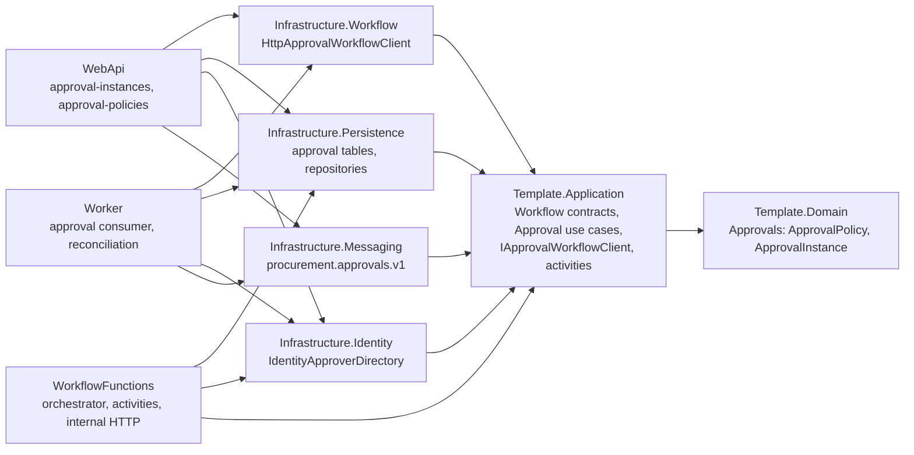
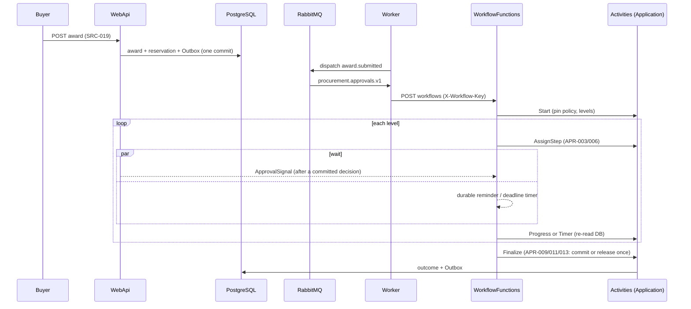

# Phase 31 report — Azure Durable approval workflow

Date: 2026-10-24 (America/Sao_Paulo). Scope: [handoff-phase-31.md](handoff-phase-31.md), APR-001..017, ADR-0003, SP-3.

## Release decision

**Ready**

Proven orchestration journey, on the real Functions host (Functions 4.x, .NET isolated, `net10.0`) with the Durable Azure Storage provider on Azurite 3.37.0 and PostgreSQL 16.15: a 12,000.00 BRL award (two levels) starts `approval-{awardId:N}` (a second start answers `AlreadyRunning`); level 1 (cost-center manager) is approved and signalled; level 2 (department head) gets its durable reminder and then passes its deadline, the timer escalates it to the `ProcurementManager` group, the level-1 approver is refused (`approval.duplicate-approver`), another group member approves, and the finalize activity commits the budget reservation, approves the award and the requisition and writes the Outbox events exactly once, and a late signal answers `NotRunning` (`SC_01_TwoHumanLevels_WithADurableEscalation_CompleteAndCommitOnce`; policy durations shortened to 60 s/15 s through a synthetic policy version). The same host proves expiry with a single release, duplicate and late signals, a host restart with replay, a lost signal repaired by the reminder timer, administrative cancellation, a rejected wrong key, and version deployment and rollback. The browser journey (inbox, detail and timeline, reasoned rejection, stale-version reload, outage message, delegation) passes Playwright with axe.

Final gate `scripts/run-phase-validation.ps1 -ComposeBaseline` (2026-10-24 07:40–08:11 America/Sao_Paulo): 25/25 steps exit 0, including the new `02c-build-workflow-functions`, `06r-test-workflow-functions` and `06s-test-workflow-emulator`. Two earlier gate runs in this phase failed and were fixed before the final run: stale Phase 29/30 tests (topology queue count, composer list, hand-composed PostgreSQL fixtures without the approval cascade, a migration check that scanned every `AwardId` column), the Worker host validating the internal key with the Test-environment in-memory client, an unopened fiscal period in the new Compose section, and the coverage ratchet (Application and Identity fell below their floors until the edge-case tests below were added; no threshold was lowered).

## Preconditions and starting state

- HEAD `1dfa1ed` (Phase 30 merged, #31) on `main`; the working tree held only this phase's changes. The work was done without a branch, commit, push or PR (handoff hard stop); after the gate passed, the owner explicitly authorized the branch `feat/phase-31-durable-approval-workflow`, area commits, push and PR on 2026-10-24. Nothing was merged or deployed.
- Phases 23–30 were Ready. Policy v1 (D23-13, B23-2, B23-11) was approved in the blueprint: L1 > 0 cost-center manager, L2 > 10,000.00 department head, L3 > 100,000.00 `FinanceApprover` group, reminder 72 h, deadline 120 h, one escalation to `ProcurementManager`, then expiry.
- No Azure resource, subscription, role assignment, secret store or deployment was touched. Every runtime ran locally in Docker with synthetic data and per-run credentials.

## Runtime and package research (verified 2026-10-23)

| Item | Source | Result |
|---|---|---|
| Isolated worker TFM | Microsoft Learn, Azure Functions supported languages and .NET isolated worker guide (updated 2026-10-12) | `net10.0` is GA on Functions 4.x; the host may share the solution TFM (no forced divergence) |
| `Microsoft.Azure.Functions.Worker` | nuget.org | 2.52.0 (MIT) |
| `Microsoft.Azure.Functions.Worker.Sdk` | nuget.org | 2.1.0 (MIT) |
| `Microsoft.Azure.Functions.Worker.Extensions.DurableTask` | nuget.org | 1.19.2 (MIT); 1.20.0 was two days old and is deferred (D31-1) |
| `Microsoft.Azure.Functions.Worker.Extensions.Http` | nuget.org | 3.3.0 (MIT) |
| `Microsoft.DurableTask.InProcessTestHost` | nuget.org | preview only, not used; a scripted `TaskOrchestrationContext` replaces it |
| Durable storage provider | Microsoft Learn, Durable Functions storage providers | default Azure Storage provider, supported on Azurite for local development (SP-3); Durable Task Scheduler emulator not needed |
| Orchestration versioning | Microsoft Learn, Durable Functions orchestration versioning | `defaultVersion`, `versionMatchStrategy`, `versionFailureStrategy` in `host.json` (D31-13) |
| Code constraints | Microsoft Learn, orchestrator code constraints | deterministic APIs only: `CurrentUtcDateTime`, `CreateTimer`, `WaitForExternalEvent`, replay-safe logger |
| Functions base image | MCR | `mcr.microsoft.com/azure-functions/dotnet-isolated:4-dotnet-isolated10.0@sha256:2fc73bed…d279` (host 4.1054.250.10, port 80) |
| Frontend `undici` | GitHub advisory GHSA-xjj6-f33q-929c (published 2026-10-23), npm registry | 7.30.1 (MIT, published 2026-10-15) pinned by an exact pnpm override (D31-15) |

License inventory: `scripts/license-inventory.ps1 -Label phase31`: 227 packages (175 production), 0 outside the policy; `System.Reactive.Compatibility` 4.4.1 accepted as a verified MIT legacy URL (D31-16). `scripts/package-graph-snapshot.ps1 -Label phase31 -CompareWith phase30`: 485 production / 858 test entries; 113 production and 181 test differences, all from the new Workflow, WorkflowFunctions and test projects and the Worker's Workflow reference.

## Project graph

`Template.WorkflowFunctions` is the only project that references the Functions and Durable packages (architecture-tested). Domain and Application reference none of them; the HTTP client adapter lives in `Template.Infrastructure.Workflow`, which only depends on `Microsoft.Extensions.Http`.

## Workflow

Steps of the handoff mapped to the code: (1) small versioned input `ApprovalWorkflowInput` (award ID, correlation, input version); (2) `Start` creates the instance and pins policy v1; (3) `AssignStep` resolves the approver; (4) assignment, reminder and escalation queue notifications through the Outbox; (5–6) `WaitAsync` races `ApprovalSignal` against the timer; (7) `Timer` reminds, escalates or expires; (8) decisions advance levels or settle rejection or cancellation; (9) `Finalize` commits or releases the reservation idempotently; (10) the outcome events carry the correlation ID.

## Determinism review

| Constraint | How it holds | Proof |
|---|---|---|
| No I/O, DI or database in the orchestrator | `ApprovalOrchestration.RunAsync` only calls `CallActivityAsync`, `CreateTimer`, `WaitForExternalEvent`, `ContinueAsNew` | `Phase31_Orchestrator_Is_Deterministic_And_Holds_No_Business_Rule` (with controlled mutations for `DateTime.UtcNow`, `Guid.NewGuid`, `Task.Delay` and a threshold comparison); `T_APR_016_D_ReplayOfTheRecordedHistory_SchedulesTheSameCommands_WithoutReplayLogs` |
| No ambient clock | timers use instants returned by activities (stored in history); the poison backoff uses `context.CurrentUtcDateTime` | `T_APR_011_D_ReminderThenDeadline_CallTheTimerActivityWithTheRecordedInstant` |
| No random IDs | instance ID derived from the award (`approval-{awardId:N}`) | `InstanceIds_AreDerivedFromTheAwardOnly` |
| Replay-safe logging | `CreateReplaySafeLogger` only | replay test asserts no log during replay |
| No thread blocking | async only, `Task.WhenAny` over durable tasks; the cancellation source only cancels the losing durable task | scripted context tests |
| Ordered collections | no dictionary or set iteration in the orchestrator | source review |
| Bounded history | `ContinueAsNew` after 50 waits, unprocessed events preserved | `ContinueAsNew_TruncatesHistoryAfterTheWaitBudget_AndPreservesSignals` |
| Versioned code paths | an unknown version throws before any command | `T_Versioning_UnknownOrchestrationVersions_HaveNoCodePath` |

## State ownership

- **PostgreSQL (business truth)**: `ApprovalPolicies`/`ApprovalPolicyLevels` (immutable once used, APR-017), `ApprovalInstances`, `ApprovalSteps`, append-only `ApprovalHistory`, audit records, Outbox/Inbox, and the award, requisition and reservation states. Every APR rule is evaluated here, in Domain methods called by Application use cases.
- **Durable history (process state only)**: which activity ran, the timer instant and the signal arrival. It holds the award ID, correlation ID, level, timer kind and status strings only: no names, e-mail addresses, amounts, reasons or secrets (NFR-SEC-7).
- **Reconciliation (APR-016)**: `GET /api/v2/approval-instances/reconciliation` lists awards in `PendingApproval` without an instance, pending instances whose orchestration is missing, failed, terminated or completed, and instances waiting past their timer. `POST .../reconciliation/repair` and the Worker sweep start missing workflows and re-signal stalled ones; nothing is repaired by editing Durable history.

## Security

- Permissions: `approvals.decide`, `approvals.delegate`, `approvals.administer`, `approvals.read-all`, `approvals.policies.manage`, assigned in the seeded role matrix and checked by `[HasPermission]` (never role names).
- Separation of duties: APR-005 (requester never gives the final approval), APR-007 (one level per user), APR-008 (submitting buyer never gives the final approval), APR-006 (ineligible resolution goes to the escalation group), all in the Domain and returned as stable 403 codes.
- Internal boundary: `X-Workflow-Key` (at least 32 characters, constant-time comparison of SHA-256 digests); a wrong key answers 401 and is reported by the client as `approval.workflow-unavailable`. No Durable management URL, check-status payload or host key leaves the Functions host; the host publishes no port in Compose (D31-3). The key is documented in [configuration-secrets.md](../configuration-secrets.md); `local.settings.json` is git-ignored.
- Every decision, delegation, reassignment, cancellation and denied attempt writes an append-only audit record with allow-listed detail keys; reasons are length-bounded (10–500).
- STRIDE: spoofing (session bearer plus internal key), tampering (ETag/`If-Match`, idempotency keys, immutable policy versions), repudiation (audit and history with correlation IDs), information disclosure (participant-only detail visibility, D31-6; no personal data in Durable history), denial of service (bounded retries and poison rounds, rate-limited authentication, `ContinueAsNew`), elevation of privilege (administrators reassign or cancel but never approve, APR-015).

## Instance and version strategy

- One instance per award: `approval-{awardId:N}`. A duplicate start of a running instance is a no-op (`NonRunningStates`); a start for an award that left approval completes without waiting (`T_APR_001_D_StartForAnAwardThatLeftApproval_CompletesWithoutWaiting`).
- Duplicate, late and out-of-order signals are harmless because the orchestrator re-reads the database after each one (`T_APR_014_D_*`).
- Terminate is used only by administrative cancellation and invalidation, after the database commit; purge is not exposed.
- Deployment: the host runs `defaultVersion 1.0` with `CurrentOrOlder`/`Reject`. A newer host (2.0) finishes 1.0 instances on the 1.0 code path; an instance stamped with a version the build has no code path for fails before any business effect; after a rollback to the older host, reconciliation restarts the instance from database state ("restarted") and it completes (`T_Versioning_ANewerHostFinishesOlderInstances_AndARollbackIsRepairedByReconciliation`). A later breaking change adds a new branch and keeps 1.0 until no instance uses it.

## Tests and counts

| Suite | Phase 30 | Phase 31 | Notes |
|---|---:|---:|---|
| Architecture | 71 | 75 | Functions packages confined to the host, deterministic orchestrator with controlled mutations, no Durable type in Core, composition roots |
| Unit | 717 | 789 | Approval domain, handlers, edge cases (validators, outages, races, reassignment, queries, policies, reconciliation, planner) |
| Integration | 256 | 266 | `HttpApprovalWorkflowClient` against the loopback fake server, registration, topology |
| PostgreSQL | 61 | 68 | migration down/up, SC-01, concurrent starts and decisions, single release, supplier invalidation, reconciliation queries |
| RabbitMQ | 28 | 29 | `T_APR_001_W` award.submitted reaches the approval consumer and the projection |
| Elasticsearch / Redis / Azurite | 13 / 23 / 6 | 13 / 23 / 6 | unchanged |
| Worker | 1 | 1 | real Worker host composition |
| WorkflowFunctions (new) | — | 26 | scripted orchestrator branches and host boundary (key, settings, transient classification, approver directory) |
| WorkflowFunctions emulator (new) | — | 7 | real Functions host + Azurite + PostgreSQL |
| Functional | 362 | 371 | 9 approval journeys incl. delegation through the Identity directory, reassignment, reconciliation and policy versions; permission matrix |
| Frontend Vitest / Playwright | 67 / 11 | 78 / 15 | approval Application rules, adapter, inbox/detail journeys with axe |

### Coverage (gate step `07b-coverage`)

Merged Cobertura of unit, integration, functional and WorkflowFunctions tests (`discovered = executed = passed`: 789, 266, 371, 26). Domain 99.2 % line; Application 97.83 % line / 90.01 % branch (floor 96/90); Identity 93.87/81.76 (floor 89/79); new Template.Infrastructure.Workflow 98.04/92.86 (floor 97/91); new Template.WorkflowFunctions 17.18/36.99 (floor 16/35: the HTTP functions, activities and host wiring are exercised by the opt-in emulator suite on the real host, which is not part of the merged coverage, like the Phase 30 blob adapter). `minimumSources` raised to the measured counts (Domain 46, Application 132, Identity 19, Persistence 35, WebApi 71); no threshold lowered.

### Rule-to-test matrix

| Rule | Domain (unit) | Application (unit) | Orchestrator (scripted) | Emulator (Functions + Azurite + PostgreSQL) | PostgreSQL | Functional / E2E |
|---|---|---|---|---|---|---|
| APR-001 | `T_APR_001_b_Start_PinsThePolicy_DerivesTheWorkflowId_AndWaitsForAssignment` | `T_APR_001_a_TheStarter_TurnsAwardSubmittedIntoAnIdempotentStart`, `T_APR_001_a_StartAfterTheAwardLeftApproval_ReturnsNotStarted` | `T_APR_001_D_TheStartActivityReceivesTheStampedVersion`, `T_APR_001_D_StartForAnAwardThatLeftApproval_CompletesWithoutWaiting` | SC-01 journey | `T_APR_001_a_ConcurrentDuplicateStarts_CreateOneInstance` | RabbitMQ `T_APR_001_W_AwardSubmitted_ReachesTheApprovalConsumer_AndTheProjection_ButNotNotifications` |
| APR-002 | `T_APR_002_a_RequiredLevels_FollowTheExclusiveThresholds`, `T_APR_002_a_ZeroAmount_IsRejected` | — | — | SC-01 (two levels for 16,200.00) | `Migration_IsAdditive_SeedsPolicyVersion1_AndRollsBackToPhase30_ThenReapplies` (seeded thresholds) | functional SC-01 |
| APR-003 | — | `T_APR_003_a_MissingOrInactiveAssignees_FallBackToTheEscalationGroup` | — | SC-01 | — | — |
| APR-004 | `T_APR_004_a_OnlyTheAssigneeHoldingDecide_DecidesTheCurrentStep`, `T_APR_004_a_AnyMemberOfTheAssignedGroup_Decides` | `T_APR_004_a_ADecisionByANonAssignee_IsDeniedAndAudited` | — | — | — | `Visibility_RequesterReadsButCannotDecide_OutsidersSeeNothing`, permission matrix |
| APR-005 | `T_APR_005_a_TheRequester_CannotGiveTheFinalApproval`, `T_APR_005_a_TheRequester_MayApproveANonFinalLevel` | — | — | — | — | — |
| APR-006 | `T_APR_006_a_AssigningAnIneligibleUser_IsRejected_ButARoleGroupIsAccepted` | `T_APR_006_a_TheRequesterAsFinalApprover_ResolvesToTheEscalationGroup` | — | — | — | E2E delegation (ineligible candidates disabled) |
| APR-007 | `T_APR_007_a_TheSameUser_CannotDecideTwoLevels` | — | — | — | — | — |
| APR-008 | `T_APR_008_a_TheSubmittingBuyer_CannotGiveTheFinalApproval` | — | — | — | — | — |
| APR-009 | `T_APR_009_a_Rejection_NeedsAReason_AndSettlesTheOutcomeOnce` | `T_APR_009_b_RejectionReleasesTheReservationOnce_AndEndsTheRequisition` | — | — | `T_APR_009_a_ConcurrentFinalizationOfARejection_ReleasesTheReservationOnce` | `T_APR_009_b_RejectionNeedsAReason_AndReleasesTheReservation`; E2E reasoned rejection |
| APR-010 | `T_APR_010_a_Delegation_KeepsTheDueTime_AndRejectsInvalidTargets` | `T_APR_010_a_DelegationThroughTheUseCase_NotifiesTheDelegate`, `T_APR_010_a_Delegation_ToAnIneligibleUser_IsRejected` | — | — | — | E2E delegation |
| APR-011 | `T_APR_011_a_Reminder_Escalation_AndExpiry_FollowThePinnedDurations`, `T_APR_011_a_TimersOfAnotherLevel_OrADecidedStep_AreNoOps` | `T_APR_011_b_DeadlinesEscalateThenExpire_AndReleaseOnce` | `T_APR_011_D_ReminderThenDeadline_CallTheTimerActivityWithTheRecordedInstant` | `T_APR_011_D_WithoutDecisions_TheApprovalExpires_AndReleasesTheReservationOnce`, SC-01 escalation | — | E2E overdue and escalated display |
| APR-012 | `T_APR_012_a_Invalidation_EndsAPendingInstance_Once` | `T_APR_012_b_SupplierSuspension_InvalidatesTheApproval_AndReopensTheRfq` | — | — | `T_APR_012_b_SupplierSuspension_InvalidatesTheApproval_InTheSupplierCommit` | — |
| APR-013 | `T_APR_013_a_FinalApproval_SettlesApproved_ThenFinalizeRaisesCompleted` | `T_SC_01_TwoLevelApproval_CommitsTheReservation_AndApprovesEveryAggregateOnce` | `T_APR_013_D_TwoLevelsDecidedBySignals_FinalizeAndComplete` | SC-01 | `SC_01_TwoLevelJourney_IsPersisted_AndTheReservationIsCommittedOnce` | `SC_01_TwoLevelApproval_ThroughTheInbox_CommitsTheBudgetAndApprovesTheRequisition` |
| APR-014 | `T_APR_014_a_RepeatedDecision_IsIdempotent_OtherDecisionsConflict` | `T_APR_014_a_ConcurrentAndRepeatedDecisions_ReturnStableOutcomes` | `T_APR_014_D_DuplicateSignals_AreReadAgainstTheState_AndChangeNothing`, `T_APR_014_D_SignalsBufferedBeforeTheWait_AreConsumedInOrder` | `T_APR_014_D_DuplicateSignals_AndAHostRestart_ReplayWithoutDuplicatingEffects` | `SC_08_TwoGroupMembersDecideTheSameStep_OneDecision_OneAlreadyDecided` | E2E stale version reload |
| APR-015 | `T_APR_015_a_AdministrativeChanges_NeedAReason_AndNeverDecide` | `T_APR_015_a_AdministrativeCancel_ReturnsTheRequisitionToSourcing` | — | `T_APR_015_D_AdministrativeCancel_EndsTheOrchestration` | — | `T_APR_015_a_ManagerCancelsWithReason_AndTheRequisitionReturnsToSourcing` |
| APR-016 | — | `T_APR_016_b_Reconciliation_StartsMissingWorkflows_AndReSignalsStalledOnes` | `T_APR_016_D_ReplayOfTheRecordedHistory_SchedulesTheSameCommands_WithoutReplayLogs` | `T_APR_016_D_ALostSignal_IsRepairedByTheDurableReminderTimer`, versioning rollback | `T_APR_016_b_ReconciliationQueries_FindAwardsWithoutInstances_AndPendingInstances` | `NFR_WorkflowUnavailable_DecisionAnswers503_AndNothingChanges`; E2E outage message |
| APR-017 | `T_APR_017_a_PolicyVersion_KeepsItsFirstUse_AndValidatesNewVersions` | — | — | — | — | `Policies_AreReadable_AndANewVersionCannotStartInThePast` |

Orchestrator branches without an APR ID: `RetryPolicy_RetriesTransientFailuresOnly`, `PoisonActivity_IsRetriedAfterADurableBackoff_ThenFails`, `ContinueAsNew_TruncatesHistoryAfterTheWaitBudget_AndPreservesSignals`, `InvalidInput_IsRejectedBeforeAnyCommand`, `WaitWithoutATimer_IsAProgrammingError`. Host boundary: `InternalApi_AcceptsOnlyTheConfiguredKey`, `HostSettings_RequireALongInternalKey`, `Activities_ClassifyDatabaseAndTimeoutFailuresAsTransient_AndRuleFailuresAsPermanent`, `RequestContext_UsesTheOrchestrationCorrelation_AndBoundsItsLength`. Client adapter (`ApprovalWorkflowClientTests`, loopback fake server): key, correlation and input sent, status mapping, not-found, server/credential/timeout/malformed/refused failures as unavailable, caller cancellation propagated, registration by setting.

## Emulator evidence

`Tests/Template.WorkflowFunctions.Integration.Tests` builds the real WorkflowFunctions image, starts it with a disposable Azurite 3.37.0 and PostgreSQL 16.15 (Testcontainers, pinned by digest, synthetic data and per-run key), and drives it through the internal HTTP boundary with policy durations shortened through a synthetic policy version.

Policy durations in the suite: step deadline 60 s, reminder after 15 s (a synthetic policy version; the seeded v1 keeps 120 h/72 h). Images: `postgres:16.15@sha256:ca0bd484…b641d`, `mcr.microsoft.com/azure-storage/azurite:3.37.0@sha256:830430c1…71fd5`, and the WorkflowFunctions image built from its Dockerfile (or `TEMPLATE_WORKFLOW_FUNCTIONS_IMAGE`).

| Test | What the real host proved |
|---|---|
| `SC_01_TwoHumanLevels_WithADurableEscalation_CompleteAndCommitOnce` | 12,000.00 BRL award: duplicate start is `AlreadyRunning`; level 1 assigned in under 10 s (NFR-PERF-7 assertion) with policy and workflow version pinned; level 1 approved by signal; level 2 reminded and then escalated by durable timers; the level-1 approver is refused (`approval.duplicate-approver`); a group member approves; reservation committed once, award and requisition approved, orchestration `Completed`, late signal `NotRunning` |
| `T_APR_011_D_WithoutDecisions_TheApprovalExpires_AndReleasesTheReservationOnce` | reminder, escalation and second deadline from durable timers only; instance `Expired`, reservation released once |
| `T_APR_014_D_DuplicateSignals_AndAHostRestart_ReplayWithoutDuplicatingEffects` | repeated signals, then the host container is stopped and started; the orchestration replays from Azurite history and finishes with one decision, one commit and one set of events |
| `T_APR_016_D_ALostSignal_IsRepairedByTheDurableReminderTimer` | a decision committed without a signal is picked up by the next durable timer |
| `T_APR_015_D_AdministrativeCancel_EndsTheOrchestration` | cancel commits, the orchestration ends, and the requisition is back in `InSourcing` |
| `InternalBoundary_RejectsAWrongKey_AsUnavailable` | a wrong `X-Workflow-Key` answers 401 and the client reports `approval.workflow-unavailable` |
| `T_Versioning_ANewerHostFinishesOlderInstances_AndARollbackIsRepairedByReconciliation` | a host stamping 2.0 finishes an in-flight 1.0 instance on the 1.0 path; a new instance started on that host fails before any business effect (this build has no 2.0 path); after rolling back to the 1.0 host, reconciliation restarts it ("restarted") and it completes on 1.0 |

Gate step `06s-test-workflow-emulator`: 7/7 in 6 min 14 s on this machine (Docker Desktop 28.4.0).

## Compose

`docker-compose.yml` adds `workflow-functions` (built from `Src/Functions/Template.WorkflowFunctions/Dockerfile`, no published port, no fixed container name, liveness `GET /api/health/live`) and `workflow-storage` (Azurite 3.37.0 pinned by digest, blob/queue/table, `workflow-storage-data` volume). The WebApi and the Worker receive `ApprovalWorkflowSettings__Enabled=true`, `BaseUrl=http://workflow-functions/api/` and the key from `APPROVAL_WORKFLOW_KEY`; `.env.example` holds `CHANGE_ME` only. `scripts/compose-baseline.ps1` adds a Phase 31 section: the Functions host has no public port or fixed name, the internal key comes from the environment and is the same in the three services, the task-hub Azurite is separate and pinned, both new services are healthy and `health/ready` reports the database and task hub; the internal API answers 401 without the key; the period is opened, a requisition submitted, a supplier activated and an RFQ awarded through the public API; the Outbox → RabbitMQ → Worker → Functions path creates the instance and assigns level 1 (to the `ProcurementManager` group, the cost center has no manager, APR-006) in 3 s; the instance and its runtime (`Running`) are visible through the API; with the Functions host stopped a decision answers 503 and changes nothing while the rest of the API keeps working; after the host restarts the orchestration is still `Running`; the administrative cancel ends the orchestration (`Completed`) and returns the requisition to `InSourcing`; the approval events are dispatched; the key never appears in the Functions log. Run `p14-baseline-20261024063646`: 158/158 checks, from clean volumes, ending with `stop` and nothing deleted.

## Contracts and screens

- OpenAPI v2 (`docs/refactoring/baseline-phase-31`): 14 additive operations; v1 identical to Phase 30. `approval-instances`: list (inbox with `assignedTo=me`, status, escalation, sort), get, history, workflow diagnostics, decision, delegate, delegates, reassign, cancel, reconciliation and repair; `approval-policies`: list, get by version, create. Changes need `If-Match` and `Idempotency-Key`; responses carry `ETag`; Problem Details carry the stable `approval.*` codes.
- Events: nine approval integration events (`procurement.approval.started`, `step-assigned`, `reminder-due`, `step-escalated`, `completed`, `rejected`, `expired`, `invalidated`, `cancelled`), the queue `procurement.approvals.v1` with its DLQ, and six of them routed to the notification queue.
- Angular (`Client/Template.WebApp`): Application `approvals.ts` (port and presentation rules; eligibility always from `allowedActions`), Infrastructure `ApprovalApiAdapter` (generated client, quoted `If-Match`, fresh `Idempotency-Key`), Presentation `/approvals/inbox` (permission `approvals.decide`, due and escalation badges) and `/approvals/:id` (frozen award and comparison, steps with due time, reminder and escalation count, timeline, approve with an optional comment, reject/delegate/cancel with a 10–500 character reason, stale-version reload, outage message). Strings in pt-BR and English. Frontend gates: Vitest 78/78 (25 files), Playwright 15/15 with axe (4 new approval journeys), dependency-cruiser 184 modules/382 dependencies with no violation and 5/5 mutations rejected, 185 generated files without drift, production build, 458 license records approved, `pnpm audit --audit-level high` clean after the `undici` override (D31-15).

## Rollback

- Code: the phase is additive. Disabling `ApprovalWorkflowSettings:Enabled` in the WebApi and the Worker makes decisions answer 503 `approval.workflow-unavailable` and leaves award submissions waiting in the queue; nothing is lost.
- Schema: migration `20261023234947_Phase31ApprovalWorkflow` is additive (five tables plus the policy v1 seed) and its `Down` to Phase 30 and re-apply are rehearsed on PostgreSQL (`Migration_IsAdditive_SeedsPolicyVersion1_AndRollsBackToPhase30_ThenReapplies`). No existing column changed.
- Orchestrations: rolling back the Functions image is covered by the versioning strategy; reconciliation restarts instances from the database. Durable history is never edited or purged, and orchestration or storage state was not deleted by any script.
- Frontend: the new routes and the `undici` override can be removed independently.

## Residual risks and deliberate limits

- Only the Azure Storage provider on Azurite was exercised; no Azure deployment, scale-out with several Functions instances, or Durable Task Scheduler was tested.
- Notifications are in-app records through the local adapter; e-mail delivery stays in Phase 33.
- Signals after a committed decision are best effort; the worst case is a delay until the next reminder/deadline timer or the 5-minute reconciliation sweep.
- Durable history retention and purge policy are not automated; purge is not exposed and needs a separate decision.
- `Worker.Extensions.DurableTask` 1.20.0 is deferred (D31-1).
- Category- or cost-center-specific chains remain deferred (decision log).

## Gates

| Gate | Result |
|---|---|
| `01-restore`, `02-build-webapi`, `02b-build-worker`, `02c-build-workflow-functions` | succeeded, 0 warnings, 0 errors (SDK 10.0.402) |
| `03-test-architecture` | 75/75 |
| `04-test-unit` | 789/789 |
| `05-test-integration` | 266/266 |
| `06-test-postgresql` | 68/68 (`postgres:16.15` pinned by digest) |
| `06b-test-rabbitmq` | 29/29 (`rabbitmq:4.3.6-management`) |
| `06c-test-elasticsearch` / `06f-test-redis` / `06p-test-azurite` | 13/13 / 23/23 / 6/6 |
| `06q-test-worker` | 1/1 |
| `06r-test-workflow-functions` | 26/26 |
| `06s-test-workflow-emulator` | 7/7 (6 min 34 s) |
| `06e-compose-baseline` | 158/158 (`p14-baseline-20261024075438`, from clean volumes, ends with `stop`, nothing deleted) |
| `07-test-functional` | 371/371 |
| `07b-coverage` | OK (every module at or above its ratchet) |
| `08-vulnerable-packages` | no vulnerable package in 27 projects |
| `09-docker-compose-config` | succeeded with `.env.example` placeholders |
| `10-capture-openapi` | v1 identical to Phase 30; v2 identical to `docs/refactoring/baseline-phase-31` (14 additive operations) |
| `11-graphify` | 14,681 nodes, 39,756 edges, 470 communities |
| `12-git-diff-check` | exit 0 |
| `13-secret-scan` | OK: 7 settings files, 8 Compose/env templates, compromised fingerprint absent from 11,254 files |
| Deprecated packages | only the xunit 2.9.3 family (test-only, deferred) |
| Licenses / package graph | 227 packages, 0 outside policy (D31-16); graph differences only from the new projects |
| Frontend | `pnpm validate` green, `audit:licenses` 458 records approved, `audit:security` no high finding after D31-15, Playwright 15/15 |

Not run in this phase (scope unchanged): the Phase 11/15–18 infrastructure upgrade rehearsals and the VSIX validation. No Azure resource was provisioned or deployed, and no orchestration or storage state was deleted.
