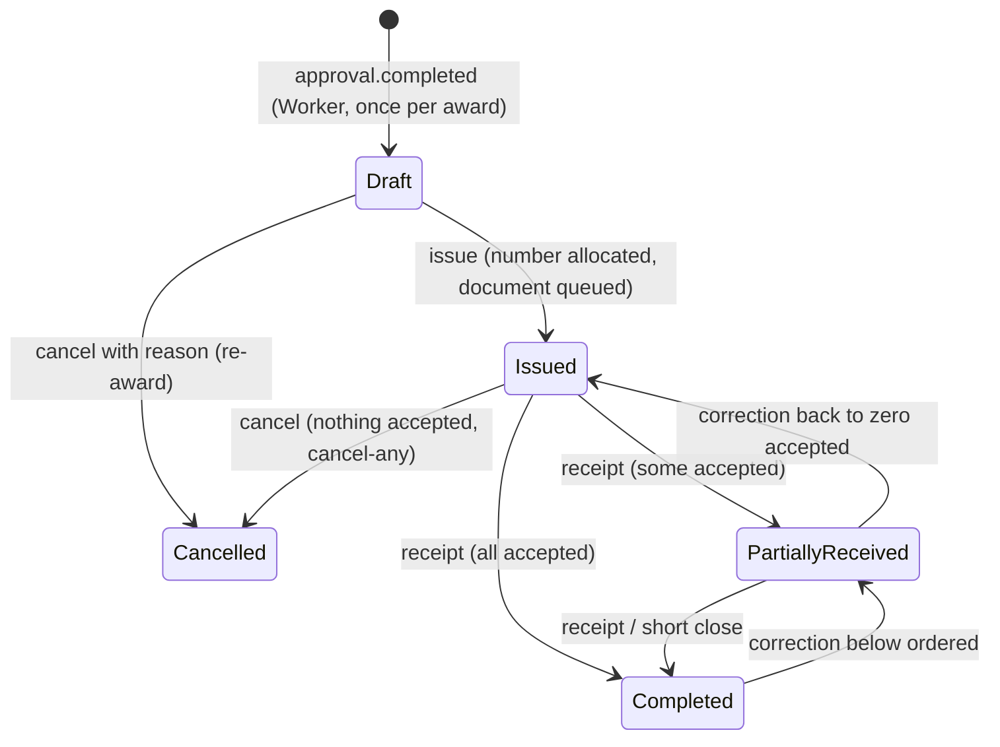

# Phase 32 report — Purchase orders and receiving

Date: 2026-10-24 (America/Sao_Paulo). Scope: [handoff-phase-32.md](handoff-phase-32.md), PUR-001..011, RCV-001..008, CALC-006/008/009, SP-2, D23-18.

## Release decision

**Ready**

Proven lifecycle: an award approved through the Phase 31 orchestration produces exactly one numbered purchase order with an immutable, auditable commercial snapshot, and the order travels to a completed receipt through the API, the Worker and the browser.

- **Exactly one order per award (PUR-001).** The Worker purchasing consumer turns `procurement.approval.completed` into one draft. The Inbox row and the effect commit in one transaction, and a unique index on `AwardId` settles races between consumers. Proven by a redelivery and a second event copy in unit and functional tests, and by four concurrent consumers on PostgreSQL 16.15. On the isolated Compose stack the real Functions host finalized the approval and the order appeared through Outbox → RabbitMQ → Worker.
- **Gapless numbering (PUR-005, SP-2).** The issue allocates `PO-{yyyy}-{nnnnnn}` from a per-year counter row inside the issue transaction, after every guard. Four parallel issues plus a parallel repeat produced exactly `000001..000004` with the counter at 4, a number allocated in a rolled-back transaction was handed out again (`000005`), and a repeated issue returns the same number (PUR-006).
- **Immutable snapshot (PUR-002, CALC-006).** Supplier identity, address and contact, the awarded lines and prices, freight, discount, taxes included, payment terms and the CALC-007 rates are copied by value; the total must equal the award exactly. After issue every change answers `purchase-order.immutable`; master-data edits never reach the order.
- **Document and notification failures are visible and retryable (PUR-007).** The issue queues a Phase 30 report job (`PurchaseOrderPdf`, `purchase-order-pdf.v1`) in the same commit. The Worker renders it with headless Chromium, the order records the file ID and template version, and the supplier notification is delivered once per attempt through the local adapter. A failed document or notification is shown on the order and retried without unissuing, renumbering or duplicating anything; the Compose run issued with the Worker stopped and the document became ready after the restart.
- **Receipt arithmetic and tolerance (RCV-001..008, CALC-009).** Partial receipts, a rejected quantity with a discrepancy, the over-receipt guard (cap = ordered with the 0 % tolerance of `ReceivingPolicy` v1), compensating corrections that reopen and complete the order again (SC-07), and four concurrent receipts serialized on the order row (only the two that fit the cap succeed).
- **Cancellation and completion exactly once (PUR-008/009/010).** Draft cancel returns the award, commitment and requisition to sourcing; issued cancel (ProcurementManager scope) releases the commitment once; short close releases CALC-008 once; completion and reopening move the requisition `Ordered ↔ Closed` with one event per transition.
- **Requisition-to-receipt UI.** Playwright drives the requisition link to the draft order, issue with confirmation, the document download, the receiving queue, the partial receipt editor with discrepancy capture and remaining balance, the correction and the final receipt, with axe on every screen and a mobile run.

All 25 gate steps are green against the final workspace (`run-phase-validation.ps1 -ComposeBaseline`, 2026-10-24 11:17-11:59 America/Sao_Paulo, plus two step reruns after fixes): the first run had two failures, `06e-compose-baseline` 179/181 (the script still compared OpenAPI with the Phase 31 baseline; every Phase 32 check passed) and `07b-coverage` (Application branch coverage 88.46 % < 90 %). The script now targets `baseline-phase-32` and the rerun passed 181/181 (`p14-baseline-20261024153506`); 13 new edge-case unit tests raised Application branch coverage to 90.02 % and the coverage step passed. No threshold was lowered.

## Preconditions and starting state

- HEAD `01ca9c1` (Phase 31 merged, #32) on `main`, clean working tree; the merge was done by the owner before this phase started (the first attempt stopped because Phase 31 was only on its open PR).
- Phases 23–31 were **Ready** (their reports). The purchasing and receiving rules were already approved in the Phase 23 blueprint: PUR-001..011 and RCV-001..008, the `PO-{yyyy}-{nnnnnn}` gapless numbering (SP-2), the 0 % over-receipt tolerance (D23-18), compensating corrections, the `ShortClose` waiver as the only under-delivery closure, service receipts with their unit (RCV-008), and amendments deferred (decision log, Deferrals). No invoicing, payment, tax, NFe, inventory or warehouse requirement was introduced.
- No real supplier was contacted: the notification adapter records a local delivery row only. No Azure resource, branch, commit, push or PR was created by this phase.

## Domain and states

- `Template.Domain.Purchasing`: `PurchaseOrder` (snapshot, lines, totals, number, issue date, sub-statuses `DocumentStatus` `NotRequested/Pending/Ready/Failed` and `NotificationStatus` `NotRequested/Pending/Sent/Failed`, cancellation, short close, completion sequence, append-only `PurchaseOrderHistoryEntry`), `PurchaseOrderLine` (requisition/RFQ line reference, description, kind, unit and its decimals, quantity, unit price, line total, promised date, received/accepted/rejected totals, short-closed flag, CALC-009 cap) and `PurchasingErrors`.
- `Template.Domain.Receiving`: `Receipt` (posted on creation; receiver, local date, location, delivery reference, notes, pinned `ReceivingPolicy:1` and tolerance, lines with discrepancy type and notes, evidence metadata within FilePolicy v1 limits, appended `ReceiptCorrection`s) and `ReceivingErrors`. Receiving never references Purchasing types (architecture-tested); the order applies the receipt in the same commit.
- Shared kernel: CALC-008 `ShortCloseRelease` and CALC-009 `ReceiptCap`. Budgeting: `Uncommit` (draft cancel, `Uncommitted` history entry and `procurement.budget.reservation-uncommitted`) and `ReleasePartially` (short close, `PartiallyReleased` entry, reason `ShortClosed`). Requisitions: `LinkPurchaseOrder`, `MarkOrdered`, `FollowOrderCompletion` (`Ordered ↔ Closed`), `ReturnToSourcingFromOrder` and `CancelForOrder`. Sourcing: `WithdrawApprovedAward` and `AwardRates`.

## Numbering decision

SP-2 as approved: `INSERT INTO "PurchasingOrderNumberCounters" ("Year","LastValue") VALUES (y, 1) ON CONFLICT ("Year") DO UPDATE SET "LastValue" = "LastValue" + 1 RETURNING "LastValue"`, executed by `PurchaseOrderNumberAllocator` only inside the issue transaction (it throws without one), after every PUR-003 guard. The counter row lock serializes concurrent issues until commit; a rollback returns the value. There is no PostgreSQL sequence (architecture test and the migration check `relkind = 'S'`). The year is the organization-local issue year. The order row is also locked (`FOR UPDATE`) before the issue, so a repeated issue waits and then returns the existing number. Receipt numbers `RCV-{yyyy}-{nnnnnn}` use their own counter in a separate statement (gaps allowed, like requisitions and RFQs).

## Schema and migration

Additive migration `20261024131250_Phase32PurchaseOrdersReceiving` (application database; Identity unchanged), generated with `dotnet-ef` 10.0.13 installed only in the session scratchpad and reviewed as idempotent SQL:

| Object | Notes |
|---|---|
| `PurchasingOrders` | snapshot columns, totals `numeric(18,2)`, rates `numeric(18,6)`, sub-statuses; unique `IX_PurchasingOrders_AwardId` (PUR-001), partial unique `IX_PurchasingOrders_Number WHERE "Number" IS NOT NULL` (PUR-005); checks on totals, attempts and "issued has a number"; FKs (restrict) to requisition, RFQ, award and supplier |
| `PurchasingOrderLines` | `numeric(18,3)` quantities, `numeric(18,4)` unit price; checks: quantity and price positive, received/accepted/rejected not negative, unit decimals 0–3; unique `(PurchaseOrderId, LineNumber)` |
| `PurchasingOrderHistory` | append-only; unique `(PurchaseOrderId, Sequence)` guards concurrent appends |
| `PurchasingOrderNumberCounters` | per-year gapless counter |
| `ReceivingReceipts`, `ReceivingReceiptLines`, `ReceivingReceiptCorrections`, `ReceivingReceiptAttachments` | checks: received > 0, accepted + rejected = received, rejected requires a discrepancy type, correction delta ≠ 0, attachment length ≤ 10 MB; unique receipt number and `(ReceiptId, Sequence)` |
| `ReceivingReceiptNumberCounters` | per-year counter (gaps allowed) |
| `PurchaseRequisitions.PurchaseOrderId` | nullable `uuid`, metadata-only `ALTER TABLE … ADD` |

Only `CREATE TABLE`, `CREATE INDEX` and one nullable `ADD COLUMN`: no rewrite, no data conversion, no long lock. `Down` drops the nine tables and the column; it was rehearsed on PostgreSQL (`Migration_IsAdditive_AndRollsBackToPhase31_ThenReapplies`). Nothing is deleted by the application (receipts have no update or delete path; orders are cancelled, never removed).

## Snapshots

The draft copies, at approval completion: supplier legal name, trade name, country, tax ID, first address and first contact (as of that instant; later supplier edits never reach the order), the awarded quote revision's offered lines (description, kind, category, unit and its allowed decimals from the catalog, quantity offered, unit price), freight, discount, taxes included, payment terms, validity, delivery days, the award's CALC-007 rates and its requisition-currency total. The promised date of each line defaults to the approval local date plus the quoted delivery days. Only delivery address, promised dates and notes change while Draft (PUR-002). The buyer of record and its display name are taken at issue (D32-3). Totals are recomputed by the domain and must equal the award total (CALC-006); a mismatch throws.

## Contracts and events

- OpenAPI v2 ([baseline-phase-32](baseline-phase-32/openapi-v2.json)): 14 additive operations and 22 new schemas; `ReportParametersView.purchaseOrderId` and `RequisitionView.purchaseOrderId` are the only additive properties on existing schemas; v1 identical to Phase 31. `purchase-orders`: list (status, supplier, requisition, text, document and notification filters), get, history, `PUT` draft fields, `issue`, `cancel`, `short-close`, `document/retry`, `notification/retry`, streamed `document`. `receipts`: list, get, post (`201`), `corrections`; no `PUT`/`DELETE` (architecture-tested). Every change takes `If-Match`, every transition `Idempotency-Key`; responses carry `ETag`.
- Problem codes: `purchase-order.immutable` (409), `purchase-order.not-issuable` (422, `fields`), `purchase-order.has-receipts` (409), `purchase-order.document-not-ready` (409), `purchase-order.not-retryable` (409), `receipt.order-not-receivable` (422), `receipt.over-receipt` (422, `cap`/`resulting`), `receipt.correction-out-of-range` (422), plus the existing `supplier.not-eligible`, `invalid-transition`, `reason-required`, `validation`, version and idempotency codes.
- Integration events (Outbox v1): `procurement.purchase-order.drafted`, `issued`, `cancelled`, `completed`, `reopened`, `notification-requested`, `procurement.receipt.posted`, `discrepancy-recorded`, `corrected` and `procurement.budget.reservation-uncommitted`; the event catalog is updated. Queue `procurement.purchasing.v1` (+ DLQ) binds `approval.completed`, `report.ready`, `report.failed` and `purchase-order.notification-requested` to the Worker consumer `procurement-purchasing-v1`.
- Audit actions: `purchase-order.created/updated/issued/cancelled/completed/reopened/short-closed`, `purchase-order.document.ready/failed/retried/downloaded`, `purchase-order.notification.sent/failed/retried`, `receipt.posted/discrepancy-recorded/corrected`, `waiver.recorded` (ShortClose), `budget.reservation.uncommitted/released`, `requisition.ordered/closed/reopened/cancelled/returned-to-sourcing`, `award.withdrawn`. New allow-listed detail keys carry IDs, totals, quantities, line numbers, discrepancy types and template versions only — never supplier contacts, addresses, notes, discrepancy notes or reasons in details.

## Report and notification behavior

- Document: the issue transaction creates a `PurchaseOrderPdf` report job (system-only type, D32-4) requested on behalf of the issuer with the order ID as its only parameter. The Worker's existing report lanes claim it with a lease, `PurchaseOrderPdfBuilder` renders the issued snapshot (supplier, buyer, requisition, RFQ, payment terms, delivery address, notes, lines with promised dates, subtotal, freight, discount, total and the informational taxes-included amount) through the versioned HTML template and headless Chromium, the bytes go to private Azurite/Blob storage with a verified SHA-256 and the stored file has **no expiry** (business record). `report.ready`/`report.failed` reach the purchasing consumer, which records `DocumentReady` (file ID and template version) or `DocumentFailed` (safe code); a retry queues a new job. A stale job outcome is ignored.
- Notification: a ready document raises `notification-requested` (attempt 1); the consumer delivers only the current pending attempt through `ISupplierOrderNotifier` and records `Sent` or `Failed` (safe code). The Phase 32 adapter writes one `MessagingNotificationDeliveries` row (`Supplier`, template `purchasing.purchase-order-issued.v1`, channel `Local`) in the same transaction; no external system is contacted (e-mail is Phase 33). A cancelled order never notifies.
- Download: `GET /purchase-orders/{id}/document` streams the exact stored file (`application/pdf`, attachment) to `purchasing.orders.read` holders and audits it; storage outage answers 503 `file.unavailable`.

## UI

Angular (`Client/Template.WebApp`), through the frontend Domain/Application/Infrastructure/Presentation boundaries (dependency-cruiser: 194 modules, 418 dependencies, no violation, 5/5 mutations rejected):

- Application `purchasing/purchasing.ts`: types, `PurchasingPort`, presentation rules (server `allowedActions` only, reason 10–500, exact decimal arithmetic for the remaining balance, RCV-002/004 mirrors, stale-error classification, stable problem keys).
- Infrastructure `PurchasingApiAdapter` over the regenerated client (211 files, no drift): quoted `If-Match`, fresh `Idempotency-Key`, Problem Details mapping, the authenticated PDF download through the API path (Blob Problem Details parsed).
- Presentation: `/purchasing/orders` (approved-order queue with status filters), `/purchasing/orders/:id` (snapshot, lines with accepted and remaining quantities, document and notification sub-statuses with retry and download, draft fields, issue/cancel/short-close confirmations with reason validation, receipts and timeline, stale-version reload), `/receiving/queue`, `/receiving/orders/:id/receipts/new` (partial receipt editor with remaining balance, received/accepted/rejected inputs, discrepancy type and notes, inline issues before posting) and `/receiving/receipts/:id` (lines, discrepancies, corrections and the correction form). Navigation entries by permission; the requisition detail links to its order. pt-BR and English strings.
- Tests: Vitest 88/88 (27 files; +10: purchasing rules and adapter), Playwright 19/19 (+4 purchasing journeys with axe, including mobile and the no-permission path).

## Full-journey tests

| Level | Test | What it proves |
|---|---|---|
| Functional (HTTP, Test host, in-process Worker effects) | `SC_01_FullJourney_ApprovedAwardToCompletedOrder_ExactlyOnceWithGaplessNumbers` | two-level approval → `approval.completed` delivered (applied, redelivered duplicate, second copy settled) → one draft → not-issuable without address → draft update → 412 stale, 403 requester → issue `PO-yyyy-nnnnnn` and same number on repeat → requisition Ordered → immutable after issue → Worker report attempt → document Ready → notification Sent once (redelivery duplicate) → PDF download (403 for the receiver) → receiver sees no prices → 12 received / 10 accepted / 2 rejected with discrepancy → over-receipt 422 → completion → requisition Closed → correction out of range 422 → correction −1 reopens (requisition Ordered) → final receipt completes → history, Outbox events and audit |
| Functional | `T_PUR_008_DraftCancel…`, `T_PUR_008_T_PUR_010_IssuedCancelScope…`, `T_PUR_008_IssuedCancel_WithoutAcceptedQuantity…`, `T_PUR_007_DocumentAndNotificationFailures…`, `T_PUR_011_Visibility_And_RCV_002_004_005_Validation`, `OpenApi_DocumentsThePurchasingAndReceivingOperations` | cancel paths and budget effects, short close with CALC-008, document failure and retry, notification failure and retry, visibility and validation, contract |
| PostgreSQL 16.15 | `PurchasingPostgreSqlTests` (6) | migration and rollback, concurrent consumers, parallel issues gapless with rollback, concurrent receipts within the cap, concurrent cancels release once, short-close persistence |
| RabbitMQ 4.3.6 | `T_PUR_001_W_ApprovalCompletion_ReachesThePurchasingConsumerOnce_AndNotTheApprovalQueue` | routing, redelivery, drained queue, empty DLQ |
| Integration (real Chromium) | `T_PUR_007_e_PurchaseOrderPdf_RendersTheIssuedSnapshot_FromTheRealBuilderAndRepository` | PdfPig semantic assertions: number, supplier, buyer, totals, promised dates, template version, escaped markup |
| Worker host | `PurchasingConsumer_ResolvesAndSettlesAnUnrelatedReport_WithTheSystemActor` | the real Worker composition resolves the consumer (found a missing `IApproverDirectory` registration, fixed by D32-3) |
| Compose | Phase 32 section of `compose-baseline.ps1` | real approval through the Functions host → Worker draft → issue during a Worker outage → Chromium PDF after restart → local supplier delivery → over-receipt rejected → completion → events dispatched → counter advanced once → document persisted across a full stack restart |
| Playwright | `e2e/purchasing.spec.ts` (4) | requisition → draft → issue → download; receiving queue → partial receipt with discrepancy → correction → completion; stale issue reload on mobile; no-permission menu and routes |

### Rule-to-test matrix

| Rule | Domain (unit, mock-free) | Application (unit, port fakes) | PostgreSQL / RabbitMQ / Worker | Functional / E2E |
|---|---|---|---|---|
| PUR-001 | `T_PUR_001_a_T_CALC_006_a_DraftCopiesTheAwardedRevision_AndItsTotalExactly` | `T_PUR_001_a_ApprovalCompletion_CreatesExactlyOneDraft_ForDuplicatesAndCopies`, `T_PUR_001_b_ADuplicateRaceOnTheAward_AndALeftRequisition_AreSettledWithoutAnOrder` | `T_PUR_001_a_ConcurrentConsumers_CreateExactlyOneDraftPerAward`, `T_PUR_001_W_…`, Worker composition | SC-01 |
| PUR-002 | `T_PUR_002_a_OnlyTheDeliveryFieldsChangeInDraft_ThenEverythingIsImmutable` | `T_PUR_011_a_…` (duplicate promised dates) | — | SC-01 (immutable after issue), E2E buyer journey |
| PUR-003 | `T_PUR_003_a_EachIssueGuard_IsReported_AndNothingChanges` | `T_PUR_003_b_IssueGuards_AreCheckedBeforeANumberIsAllocated` | — | SC-01 (not-issuable), E2E |
| PUR-004 / CALC-006 | `T_PUR_001_a_T_CALC_006_a_…` | — | — | SC-01 (total 16,200.00) |
| PUR-005 / SP-2 | `T_PUR_005_a_T_PUR_006_a_IssueAllocatesTheNumberOnce_AndQueuesTheDocument` | `T_PUR_005_b_T_PUR_006_b_…`, `T_PUR_005_c_ALostCommitRace_Answers412_AndRollsBack` | `T_PUR_005_a_ParallelIssues_GetUniqueGaplessNumbers_AndARollbackReturnsTheNumber`, Compose counter | SC-01 |
| PUR-006 | `T_PUR_005_a_T_PUR_006_a_…` | `T_PUR_005_b_T_PUR_006_b_…` | parallel repeat in `T_PUR_005_a_…` | SC-01 (repeat with old ETag) |
| PUR-007 | `T_PUR_007_a_DocumentAndNotificationFailures_AreRetryable_WithoutRenumbering` | `T_PUR_007_b_…`, `T_PUR_007_c_…`, `T_PUR_007_d_…` | real Chromium `T_PUR_007_e_…`, Compose Worker outage | `T_PUR_007_DocumentAndNotificationFailures…`, E2E download |
| PUR-008 | `T_PUR_008_a_DraftAndIssuedCancel_NeedAReason_AndStopOnceAccepted`, `T_PUR_008_b_T_PUR_010_b_BudgetCommitmentMovesBackOrPartially_AndNeverTwice` | `T_PUR_008_c_…`, `T_PUR_008_d_…`, `T_PUR_001_b_…` (REQ-008 cascade) | `T_PUR_008_b_ConcurrentIssuedCancels_ReleaseTheCommitmentOnce` | `T_PUR_008_DraftCancel…`, `T_PUR_008_IssuedCancel_WithoutAcceptedQuantity…`, `T_PUR_008_T_PUR_010_…` |
| PUR-009 | `T_RCV_003_a_T_PUR_009_a_…`, `T_RCV_007_a_T_PUR_009_b_…` | `T_SC_07_PartialReceipts_Correction_AndCompletion_FollowTheRequisition` | `T_RCV_003_c_…` (reopen after correction) | SC-01, E2E receiver journey |
| PUR-010 / CALC-008 | `T_PUR_010_a_T_CALC_008_a_…`, `T_CALC_008_b_T_CALC_009_a_…` | `T_PUR_010_c_ShortClose_ReleasesTheUnreceivedCommitment_WithTheWaiverAudit` | `T_PUR_010_b_ShortClose_PersistsThePartialReleaseAndTheShortClosedLines` | `T_PUR_008_T_PUR_010_…` |
| PUR-011 | — | `T_PUR_011_a_VisibilityAndPriceHiding_AndListFilters`, `T_PUR_007_d_…` (receiver download) | — | `T_PUR_011_Visibility…`, permission matrix, E2E no-permission |
| RCV-001 | `T_RCV_003_a_…` (not receivable after completion), `T_RCV_003_b_…` (draft) | `T_PUR_010_c_…` | — | `T_PUR_008_T_PUR_010_…`, `T_PUR_011_…` |
| RCV-002 / RCV-008 | `T_RCV_002_a_T_RCV_008_a_…`, `T_RCV_002_b_…` (theory), `T_RCV_002_c_…` | `T_RCV_004_b_…` | — | `T_PUR_011_…` (unbalanced, fractional), E2E inline issues |
| RCV-003 / CALC-009 | `T_RCV_003_a_…`, `T_RCV_003_b_…`, `T_CALC_008_b_T_CALC_009_a_…` | `T_SC_07_…` | `T_RCV_003_c_ConcurrentReceipts_SerializeOnTheOrderRow_AndNeverExceedTheCap`, Compose over-receipt | SC-01, E2E over-remaining |
| RCV-004 | `T_RCV_004_a_ARejectedQuantity_NeedsADiscrepancyTypeAndNotes_AndIsRecorded` | `T_RCV_004_b_Discrepancies_AreAuditedWithoutNotes_AndQueriesFilterThem` | — | SC-01, `T_PUR_011_…`, E2E discrepancy |
| RCV-005 | `T_RCV_005_a_TheReceiverAndTheDateWindow_AreEnforced` | `T_RCV_004_b_…` (system actor forbidden) | — | `T_PUR_011_…` (future date) |
| RCV-006 | `T_RCV_006_b_T_RCV_007_a_…` | — | architecture `Phase32_Purchasing_And_Receiving_Are_Encapsulated_Append_Only_And_Gapless` | OpenAPI test (no PUT/DELETE) |
| RCV-007 | `T_RCV_006_b_T_RCV_007_a_…`, `T_RCV_007_a_T_PUR_009_b_…` | `T_SC_07_…` | `T_RCV_003_c_…` | SC-01, E2E correction |

## Real-service evidence

| Service | Evidence |
|---|---|
| PostgreSQL 16.15 (disposable, digest-pinned) | 74/74, incl. the six `PurchasingPostgreSqlTests` (additive migration and rollback to Phase 31, four concurrent consumers → one draft, parallel issues gapless `000001..000004` with a rolled-back number reused, allocator refuses to run outside a transaction, concurrent receipts within the cap, concurrent issued cancels release once, short-close persistence) |
| RabbitMQ 4.3.6 | 30/30, incl. `procurement.approval.completed` routed once to `procurement.purchasing.v1`, redelivery settled by the Inbox, empty DLQ |
| Headless Chromium (Playwright 1.64.1) | the real `PurchaseOrderPdfBuilder` + repository rendered and parsed with PdfPig (integration 267/267) |
| Azurite 3.37.0 | 6/6 (storage adapter unchanged); the Compose run stored and downloaded the PO PDF with no expiry |
| WorkflowFunctions host | emulator suite 7/7; in Compose the real Functions host finalized the approval that created the draft |
| Full isolated stack (Compose) | 181/181 (`p14-baseline-20261024153506`): synthetic procurement manager, re-award, approval through the Functions host, one draft created by the Worker, issue `PO-2026-000001` (repeat returns the same number), requisition Ordered, document pending while the Worker is stopped and ready after restart, one local supplier delivery, PDF download, file without expiry, over-receipt 422, completing receipt, requisition Closed, events dispatched, counter at 1, document persisted across a full stack restart |

## Rollback

- Code: the phase is additive. Draft creation stops if the Worker purchasing consumer is not deployed (approvals still complete; `approval.completed` stays in the queue and is consumed after redeploy). The v2 operations can be removed with their controllers; v1 is unchanged.
- Schema: `dotnet ef database update 20261023234947_Phase31ApprovalWorkflow` drops the nine Phase 32 tables and `PurchaseRequisitions.PurchaseOrderId` (loss of purchasing and receiving history — export first when needed); rehearsed on PostgreSQL 16.15.
- Documents: stored PDF files stay in blob storage with `FilesStoredFiles` rows; nothing deletes them automatically (no expiry by design).
- Frontend: the new routes, navigation entries and the requisition link can be removed independently; the regenerated client follows the baseline it is pointed at.

## Residual risks and deliberate limits

- Supplier notification is a local delivery record; real e-mail delivery (and bounce handling) is Phase 33. The PO PDF job is requested on behalf of the issuer and appears in the issuer's report-job list (not in the notification inbox).
- Evidence attachments of receipts are metadata only (bytes and malware scanning remain out of scope, like requisition attachments).
- Amendments/change orders, returns, invoices, NFe, three-way match, payments, inventory valuation, warehouse management and the supplier portal remain out of scope (Deferrals).
- `pnpm audit --audit-level high` passes, but the audit now lists 2 low and 2 moderate advisories, all in `fast-uri` < 3.1.9 reached only through `@ng-icons/core > @angular-devkit/schematics > @angular-devkit/core > ajv` (schematics tooling, not shipped in the bundle), published after Phase 31. Phase 32 adds no frontend dependency; they do not block the policy and are left for the next dependency review (an exact pnpm override to 3.1.9 would follow the D27-19 pattern).
- The PO number year is the organization-local year at issue; a time-zone change of the organization (blocked once allocations exist, ORG-004) would not renumber existing orders.

## Gates

| Gate | Result |
|---|---|
| Restore, WebApi/Worker/WorkflowFunctions builds | Succeeded, 0 warnings, 0 errors |
| Architecture | 77/77 (Purchasing/Receiving boundaries, append-only receipts, no sequence for PO numbers, controlled mutations) |
| Unit | 833/833 |
| Integration | 267/267 |
| PostgreSQL | 74/74 |
| RabbitMQ | 30/30 |
| Elasticsearch / Redis / Azurite | 13/13 / 23/23 / 6/6 |
| Worker host | 2/2 |
| WorkflowFunctions / emulator | 26/26 / 7/7 |
| Functional | 378/378 (7 purchasing journeys + the permission matrix for the 14 new operations) |
| Coverage (`07b`) | OK; Domain 99.15 line, Application 97.92/90.02 line/branch, Reporting 94.93/89.12; every module at or above its ratchet |
| Compose baseline (`06e`) | 181/181 (rerun) |
| Vulnerable packages | none; deprecated: only the xunit 2.9.3 family (unchanged) |
| License inventory (`-Label phase32`) | 227 packages, 0 outside policy |
| Package graph (`-Label phase32 -CompareWith phase31`) | 485 production / 858 test entries, 0 differences |
| OpenAPI | v1 identical; v2 identical to `baseline-phase-32` (+14 additive operations) |
| `docker compose --env-file .env.example config -q` | Succeeded |
| Graphify | 15,798 nodes, 43,470 edges, 499 communities |
| `git diff --check` / secret scan | Exit 0 / OK (8 settings files, 8 Compose/env templates, fingerprint absent from 11,341 files) |
| Frontend | Prettier (`--end-of-line auto`), lint 0, typecheck, Vitest 88/88, dependency-cruiser 194 modules/418 dependencies with 5/5 mutations rejected, API drift 211 files clean, build, licenses 458 approved, `pnpm audit --audit-level high` passes, Playwright 19/19 with axe |
